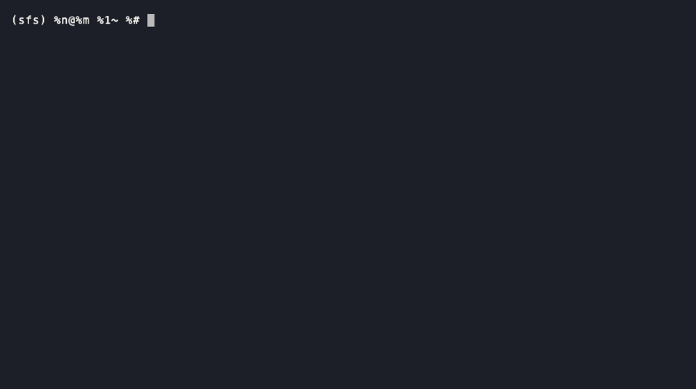

<p align="center">
  
</p>

<p align="center">
  An in-memory virtual filesystem for AI agents, written in Python.
</p>

<p align="center">
  A scratchpad for agents to create, read, modify, and organize files during execution without touching the host filesystem.
</p>

## install

```sh
git clone git@github.com:chann44/sfs.git && cd sfs
chmod +x install.sh
./install.sh
```

installs to `~/.local/share/sfs` and puts an `sfs` command on `~/.local/bin` (override with `SFS_INSTALL_DIR` / `SFS_BIN_DIR`). zero dependencies — just python ≥ 3.12.

```sh
sfs init you        # start a filesystem
sfs shell           # interactive
sfs --mcp           # run as an mcp server
./install.sh -u     # remove
```

## demo



## features

**filesystem core** (`core/setup.py`)
- `ls`, `cd`, `pwd`, `mkdir`, `mkdirs` (nested), `touch`, `read`, `write`, `edit`, `delete`, `glob`, `grep`, `tree`
- relative and absolute paths, `.` / `..` resolution
- proper errors: `FileNotFoundError`, `FileExistsError`, `NotADirectoryError`, ...

**agent surface** (`core/agent.py`)
- mirrors the same protocol langchain deep agents use: `ls`, `read` (line-paginated), `write`, `edit`, `glob`, `grep`, `delete`
- errors are data, not exceptions — every call returns a result object with an `error` field, so an llm never eats a stack trace
- `write` auto-creates parent dirs, listings are sorted and deterministic

**safety rails**
- text-only content: utf-8 validated, binary rejected
- per-file cap (default 4 kb) and total storage quota (default 1 mb), both configurable

**persistence** (`core/persist.py`)
- write-ahead log: one json line per mutation, byte-exact via base64
- crash tolerant: torn last line is skipped, corrupt lines are rejected loudly
- `compact()` rewrites the log as an atomic snapshot

**interfaces**
- cli: one-shot commands + interactive shell (`python3 main.py shell`)
- agent tools: `tools/openai.py` (definitions + executor), `tools/langchain.py` (structuredtools), `python3 main.py tools` prints the json schemas
- mcp server: `python3 main.py --mcp` — stdio json-rpc, zero dependencies

## usecases

- **agent scratchpad** — give an agent a place to write plans, notes, and intermediate artifacts during a run without touching the host disk
- **context engineering** — offload large tool outputs into files, let the agent `grep`/`glob`/`read` (paginated) only what it needs, like deep agents do
- **mcp server for any client** — claude desktop, cursor, or any mcp client gets a sandboxed fake filesystem:
  ```json
  { "mcpServers": { "sfs": { "command": "python3", "args": ["/path/to/main.py", "--mcp"] } } }
  ```
- **plug into your own agent** — openai tool-calling or langchain, two lines each:
  ```python
  from core.agent import AgentFilesystem
  from tools.openai import to_openai, execute

  afs = AgentFilesystem()
  defs = to_openai()                          # attach to any model call
  result = execute(afs, "write", {"file_path": "/plan.md", "content": "..."})
  ```
- **deterministic testing** — quota caps, text-only enforcement, and error-as-data make file-logic tests reproducible
- **safe playground** — a fake filesystem you can `rm -rf` all day; nothing on the host can break

## benchmark

```sh
python3 benchmark.py
```

500 small text files per round (agent-scratchpad shape), best of 3, apple m4, python 3.12:

| op | size | real fs | sfs | sfs+wal | agent surface |
|---|---|---|---|---|---|
| write | 256b | 19,459 ops/s | **153,559** | 33,970 | 143,659 |
| write | 4kb | 17,433 | **92,060** | 18,085 | 88,220 |
| read | 256b | 72,021 | **1,189,414** | 1,271,188 | 789,214 |
| read | 4kb | 67,362 | **1,182,732** | 1,141,553 | 349,091 |
| overwrite | 4kb | 26,513 | **63,360** | 14,081 | 62,696 |
| grep 500 files | 4kb | 64,518 | **250,789** | 247,965 | 249,340 |

takeaways:
- in-memory sfs is **5–9x faster than the real fs on writes** and **17x on reads** (5–11x through the agent surface, which pays for decode + result objects)
- `sfs+wal` lands at real-fs speed — durability costs one json append per op either way, and it's still faster than apfs at small sizes
- the total-quota check walks all files per write, which is why overwrites trail fresh writes as the tree grows — fine at scratchpad scale, the knob to turn if it ever isn't

## motivation

give agents a filesystem to think, work, and manage intermediate artifacts.

## Goals
1. able to read files from memory
2. play media files 
3. run programs 
4. WAL

## status

work in progress.

